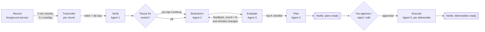
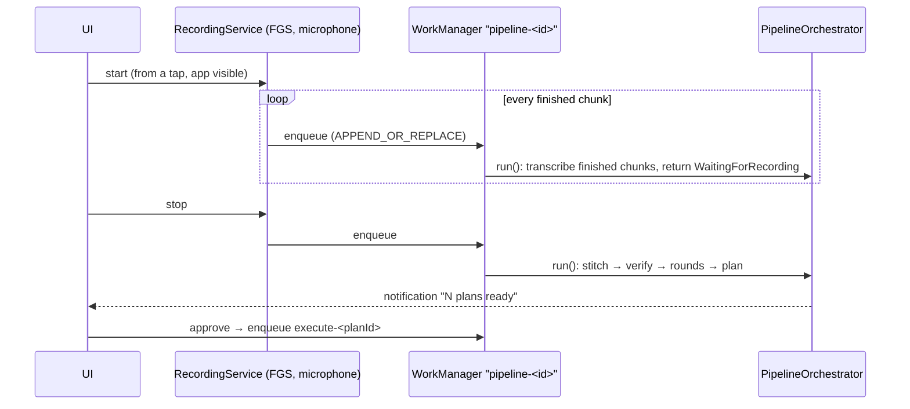
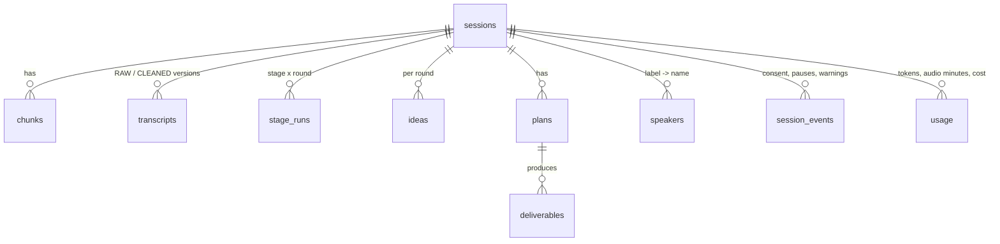

# Architecture

Idea Forge is a single-activity Jetpack Compose app (MVVM, Hilt, coroutines/Flow, Room, WorkManager)
split into three Gradle modules:

| Module | What it holds | Why separate |
|---|---|---|
| `core` | Transcript model and stitching, JSON schema validation, LLM and Whisper HTTP clients, the five agents, the pipeline orchestrator, cost metering | Pure Kotlin, so the whole pipeline is unit-tested on a plain JVM with fakes |
| `app` | UI, Room, settings and encrypted keys, recording service, WorkManager workers, notifications, export/backup | Android glue around `core` |
| `whisper` | whisper.cpp via JNI, PCM decoding, model download | Native build is optional (`ideaforge.whisperNative`) |

## Pipeline

Every box writes its output to Room before the next one starts (`stage_runs`, `transcripts`,
`ideas`, `plans`, `deliverables`). `PipelineOrchestrator.run()` always starts by skipping stages
that are already `DONE`, so a crash, process death, a WorkManager retry or a 10-minute worker
cut-off resumes from the last completed step. The Planner and Executor also save after each plan
or deliverable, so a retry never redoes finished items.

## Background execution

- One unique work chain per session serializes all runs for that session; a `Mutex` per session in
  the orchestrator is a second guard.
- Network work has a `CONNECTED` constraint and exponential backoff. Retryable failures (I/O,
  timeouts, HTTP 408/429/5xx) put the stage back to `PENDING` and the worker returns `retry()`.
  This is how airplane mode works: work waits and resumes when the network returns.
- Non-retryable failures (bad key, unknown model, invalid JSON twice) mark the stage `FAILED` with
  the message, notify, and wait for you to fix settings and tap Resume or Re-run.
- Before every LLM call `MeteredLlm` checks the month-to-date spend against the cap; at the cap the
  pipeline pauses (`PAUSED_BUDGET`) and resumes when you raise it.

## Agents

Each agent is a class in `core/agents` that builds its user message and calls `AgentRunner`.
`AgentRunner` renders the system prompt (from `assets/prompts/<agent>.md`, or your edited copy in
app storage), calls the configured model, extracts the JSON object, validates it against
`assets/schemas/<agent>.schema.json`, and decodes it. On a parse or schema error it retries once,
showing the model its reply and the exact errors; a second failure fails the stage visibly.

Guards that do not trust the model:
- Verifier works in ~1200-word windows, keyed by segment id; missing ids keep the raw text, and a
  correction that grows a segment by more than 25% + 3 words is discarded and flagged instead
  ("never add content that was not said"). The raw transcript is insert-only and never changed.
- The shortlist is ranked in code (overall score, then fit, then impact), and early stopping compares
  shortlists by normalized titles because idea ids are not stable across rounds.
- Planner output is pinned to the idea it was asked about; Executor file names are sanitized.

## Recording

`AudioRecord` (16 kHz mono PCM) → `MediaCodec` AAC-LC (32 kbps) → ADTS `.aac` file per chunk.
ADTS frames are self-delimiting, so a file cut off by a crash or battery death still plays. When a
chunk closes it is remuxed to `.m4a` without re-encoding (exact seeking, accepted by every Whisper
API). During the last 5 s of a chunk the same PCM feeds two encoders, which is the overlap the
stitcher later removes. Chunk boundaries use audio time, so pauses do not create gaps.

## Transcript stitching

For each overlap, the cut is the midpoint. The earlier chunk keeps segments that start before the
cut; the later chunk keeps segments that end after it (word timestamps trim straddling segments
exactly). Remaining duplicate words at the seam are removed by matching the longest run (2 to 40
words) that ends the earlier side and starts the later side. See `TranscriptStitcherTest`.

## Data model

